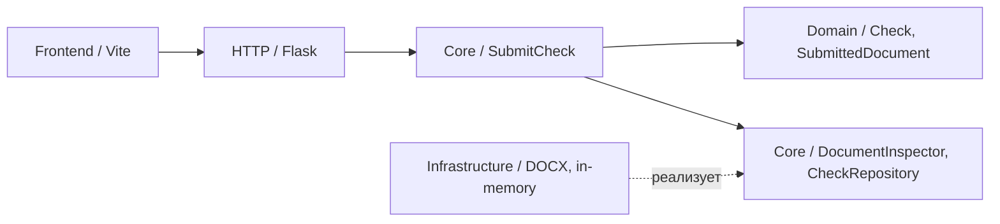

# ai-documentation-quality-control

Сервис проверки проектной документации. Локальный API принимает один DOCX, проверяет его в фоне и возвращает отчёт по идентификатору заявки. Исходник, статус и результат хранятся в памяти до перезапуска. Доступны тестовая проверка заголовка и [кандидаты R02, R03 и R01](docs/developers/docx-rule-profiles.md).

## Проверка на Windows

Откройте PowerShell в корне репозитория. Для бэкенда нужен Python 3.11 или новее.

```powershell
python -m venv .venv
.\.venv\Scripts\python.exe -m pip install -r backend/requirements.txt
.\.venv\Scripts\python.exe -m flask --app backend.http run --host 127.0.0.1 --port 8000
```

Во втором PowerShell из того же каталога создайте синтетические файлы и отправьте три запроса.

```powershell
$fixtures = Join-Path $env:TEMP 'doccheck-fixtures'
.\.venv\Scripts\python.exe -m backend.tests.fixtures "$fixtures"
$api = 'http://127.0.0.1:8000/api/v1/checks'

curl.exe -i -F "file=@$fixtures/example.docx" $api
curl.exe -i -F "empty=" $api
curl.exe -i -F "file=@$fixtures/example.txt" $api
```

| Запрос | Ожидаемый ответ |
| --- | --- |
| DOCX | `202 Accepted`, JSON с `checkId` и `status: "queued"`. Повторная отправка возвращает новый ID. |
| Без файла | `400`, `error.code: "FILE_REQUIRED"`. |
| TXT | `415`, `error.code: "UNSUPPORTED_FILE_FORMAT"`. |

При отказе API возвращает `error.message` и не создаёт заявку. Автотесты запускаются отдельной командой из корня репозитория.

После успешной отправки опрашивайте `GET /api/v1/checks/{checkId}`. При `completed` отчёт доступен через `GET /api/v1/checks/{checkId}/result`. Файл `scripts/fixtures/with-heading.docx` даёт ноль замечаний, а `scripts/fixtures/with-bold-text.docx` — одно замечание `DOCX-HEADING-01`.

```powershell
.\.venv\Scripts\python.exe -m unittest discover -s backend/tests -v
```

### Проверка в браузере

Понадобится Node.js 24 или новее. Оставьте бэкенд запущенным. Для сквозной проверки используйте фронтенд из ветки `feature/frontend-check-results` в соседнем рабочем каталоге. После публикации ветки её можно развернуть командами ниже. Если она уже открыта в соседнем рабочем каталоге, перейдите сразу в его каталог `frontend`.

```powershell
git worktree add --detach ../doccheck-frontend origin/feature/frontend-check-results
Set-Location ../doccheck-frontend/frontend
npm.cmd ci
npm.cmd run dev
```

Откройте адрес из вывода Vite, обычно `http://127.0.0.1:5173`. Vite проксирует `/api` на `http://127.0.0.1:8000`.

1. Отправьте `scripts/fixtures/with-heading.docx`. Откроется отчёт с нулём замечаний.
2. Нажмите «Новый документ» и отправьте `scripts/fixtures/with-bold-text.docx`. В отчёте появится «Не найден заголовок первого уровня».
3. Отправьте `example.txt` из папки `$fixtures`. Интерфейс покажет сообщение о неподдерживаемом формате, запрос вернёт `415`.

Если порт 8000 недоступен, запустите Flask с `--port 8021` и используйте этот порт в `$api`. В терминале фронтенда перед `npm.cmd run dev` выполните `$env:API_PROXY_TARGET = 'http://127.0.0.1:8021'`.

## Архитектура бэкенда



| Слой | За что отвечает |
| --- | --- |
| [Domain](backend/domain) | Заявка, её идентичность и начальное состояние, имя и неизменяемые байты исходника. Использует стандартную библиотеку Python. |
| [Core](backend/core) | Сценарий приёма. Проверяет расширение и содержимое через порт, затем создаёт и сохраняет заявку. Здесь объявлены интерфейсы, нужные сценарию. |
| [Infrastructure](backend/infrastructure) | Предварительная проверка упаковки DOCX и хранение заявок в памяти процесса. |
| [HTTP](backend/http.py) | Разбор multipart, лимит запроса и преобразование результата в HTTP/JSON. `create_app` связывает сценарий с адаптерами. |

Зависимости направлены к Core и Domain. Внешний контракт использует `checkId` и `status`. Привязка к этим JSON-полям и кодам HTTP происходит на границе транспорта. Успешный ответ отправляется после сохранения заявки.

### Как расширять

| Изменение | Куда вносить |
| --- | --- |
| Новое бизнес-правило или переход состояния | Инварианты и допустимые переходы хранить в Domain. Сценарий, который выполняет переход и сохраняет результат, описать в Core. |
| Чтение статуса или отчёта | Описать отдельный сценарий в Core. Добавить узкий интерфейс чтения под него и HTTP-маршрут с контрактом ответа. |
| Постоянное хранилище | Реализовать адаптер в Infrastructure и подключить его в `create_app`. Сохранить смысл операции `add`: создаётся целая заявка с доступным исходником, после чего API может вернуть `202`. |
| Расширение предварительной проверки | Код работы с форматом разместить в адаптере. Правила приёма, которые выбирают формат и определяют отказ, держать в сценарии Core. |
| Выполнение анализа | Добавить отдельный сценарий обработки по идентификатору. Анализ получает неизменяемый исходник и версию правил. Длительную обработку запускает фоновый исполнитель. |

Целевой поток проходит от приёма к анализу и затем к отчёту. Каталог правил отвечает за версии правил, анализ — за запуск и находки, отчёт — за выдачу результата. Эти границы можно реализовать внутри одного приложения. Для нового сценария проверяйте правила в Domain или Core и отдельно прогоняйте внешний контракт через HTTP.

[HLD и LLD приёма документов](docs/developers/document-intake.md) · [Контракт API](docs/developers/mvp-checks-api.md) · [Доменная модель проекта](docs/project-analysis/06-domain-model.md)
