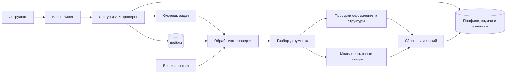

# ai-documentation-quality-control

Сервис автоматической проверки и исправления проектной документации.

## Документация

Разработчикам: начните с [сценариев, scope и версий](docs/developers/%D0%A1%D1%86%D0%B5%D0%BD%D0%B0%D1%80%D0%B8%D0%B8%20%D1%81%D0%B5%D1%80%D0%B2%D0%B8%D1%81%D0%B0%20%D0%BF%D1%80%D0%BE%D0%B2%D0%B5%D1%80%D0%BA%D0%B8%20%D0%B4%D0%BE%D0%BA%D1%83%D0%BC%D0%B5%D0%BD%D1%82%D0%B0%D1%86%D0%B8%D0%B8%20%E2%80%94%20scope%20%D0%B8%20%D0%B2%D0%B5%D1%80%D1%81%D0%B8%D0%B8.md). Это основной документ для знакомства с продуктом; границы релизов пока предварительные.

[Контекст для нейросети](docs/ai-context/README.md) — прежний подробный анализ и исходные материалы.

## назначение системы

Внутренний сервис для сотрудников одной компании, которая внедряет 1С. Проверяет уже подготовленную проектную документацию перед согласованием: оформление, структуру и согласованные языковые требования. Помогает сократить повторяющиеся ручные проверки и сделать замечания понятными и воспроизводимыми.

Правила предстоит вывести из примеров и согласовать с представителями компании. Сервис помогает автору и эксперту; окончательное согласование документа остаётся за человеком.

**Стадия проекта:** анализ и проектирование; разработка ещё не началась. Ниже описан план, а не уже работающие функции.

## словарь

| Термин | Значение |
|---|---|
| Проверка | Отдельный запуск анализа загруженного документа |
| Исходник | Загруженный файл, который хранится без изменений |
| Замечание | Место в документе, проблема, нарушенное правило и рекомендация |
| Профиль документа | Тип документа и соответствующий набор требований |
| Style Guide | Согласованные правила оформления, структуры и языка |
| Версия правил | Зафиксированный набор требований, использованный при проверке |
| Частичный результат | Отчёт, в котором явно указано, что не удалось проверить |
| Исправленная копия | Новый файл с применёнными правками; появляется в V2 |

Подробнее: [модель предметной области](docs/ai-context/project-analysis/06-domain-model.md) — историческая проработка, которую нужно уточнять по текущему scope.

## требования

### V1 — MVP: проверить готовый документ

**Сценарий:** войти → загрузить один документ → запустить проверку → получить замечания → исправить самостоятельно вне сервиса → при необходимости загрузить снова.

- Доступ только сотрудникам компании. Активный сеанс ведёт в кабинет; иначе нужен вход одним выбранным способом. При блокировке доступа — сообщение об обращении к администратору.
- В кабинете доступны новая проверка, профиль и личная история.
- При загрузке показываются имя и размер файла; тип документа выбирается при необходимости. Неподдерживаемый, слишком большой, повреждённый или защищённый файл отклоняется с понятной причиной и возможностью выбрать другой.
- После нажатия «Проверить» случайный двойной запуск блокируется. Видны состояния «Ожидает», «Проверяется», «Завершено»; закрытие страницы не останавливает обработку.
- Результат содержит сводку и замечания: место, правило, проблема, рекомендация. Отсутствие нарушений и непроверенные области обозначаются явно. При сбое доступны понятное сообщение и повторный запуск.
- История содержит дату, файл и статус: можно открыть прежний результат и скачать исходник. Повторная загрузка создаёт самостоятельную проверку.

**До пилота нужно выбрать:** способ входа, поддерживаемые форматы и типы документов, лимиты, срок хранения и удаления файлов, допустимое число одновременных проверок. DOCX — стартовый кандидат из прежнего анализа; DOC и PDF требуют отдельной оценки. «Хранить неделю» пока только пример.

### V2 — добавить исправленную копию

- Автоматически применять согласованные исправления оформления в отдельном файле.
- Выдавать исправленную копию и перечень применённых изменений; показывать оставшиеся замечания.
- Проверять целостность копии перед выдачей. Если её создание завершилось сбоем, сохранять доступ к отчёту.
- Добавить фильтрацию замечаний по категориям, поиск и фильтры истории.

Смысловые изменения остаются рекомендациями для человека.

### V3 — добавить управление доработкой

- Связывать загрузки в версии одного документа и сравнивать результаты: что исчезло и что появилось.
- Позволять выбирать, принимать и отклонять исправления.
- Добавить предпросмотр с переходом к замечанию и сравнение документа до и после.
- Собирать обратную связь об ошибочных замечаниях и поддержать пакетную загрузку.

**За пределами этих релизов:** совместный доступ, обсуждения с экспертами, согласование внутри сервиса и интеграции с корпоративными системами. Открытая регистрация и работа с несколькими компаниями в текущий scope не входят.

Общий принцип качества: пользователь видит только свои материалы; исходник сохраняется; результат связан с версией правил; неполная проверка не выдаётся за полную.

Подробности и статусы предложений: [сценарии и границы версий](docs/developers/%D0%A1%D1%86%D0%B5%D0%BD%D0%B0%D1%80%D0%B8%D0%B8%20%D1%81%D0%B5%D1%80%D0%B2%D0%B8%D1%81%D0%B0%20%D0%BF%D1%80%D0%BE%D0%B2%D0%B5%D1%80%D0%BA%D0%B8%20%D0%B4%D0%BE%D0%BA%D1%83%D0%BC%D0%B5%D0%BD%D1%82%D0%B0%D1%86%D0%B8%D0%B8%20%E2%80%94%20scope%20%D0%B8%20%D0%B2%D0%B5%D1%80%D1%81%D0%B8%D0%B8.md). [Старые требования](docs/ai-context/project-analysis/05-requirements.md) служат контекстом: их состав MVP требует пересмотра по плану выше.

## архитектурные схемы

Предлагаемая логическая схема V1. Это границы ответственности, а не обязательное разделение на отдельные сервисы.

Для развития: V2 добавляет после анализа модуль исправления и проверки копии; V3 — связи версий, сравнение и решения пользователя по правкам. Проверка, исходный файл, версия правил, результат и выходные файлы должны иметь отдельные идентификаторы и явные связи. Это позволит расширять процесс без переделки личной истории.

Асинхронные задачи отделяют интерфейс от долгой обработки и позволяют увеличивать число обработчиков. Начать можно с модульного приложения; необходимость отдельных сервисов определяется нагрузкой.

Основа предложения: [варианты архитектуры](docs/ai-context/project-analysis/07-system-boundaries-and-options.md). В старой схеме исправление включено в общий конвейер; здесь оно вынесено в V2.

## описание компонентов

| Компонент | Ответственность |
|---|---|
| Веб-кабинет | Вход, профиль, загрузка, статусы, замечания и история |
| Доступ и API | Проверка прав, создание задач, защита от двойного запуска, выдача результатов |
| Хранилище данных и файлов | Связи сотрудника с проверками, неизменяемые исходники, результаты и сроки хранения |
| Очередь и обработчик | Фоновая обработка, сохранение статусов и ошибок |
| Разбор документа | Извлечение текста, структуры и свойств оформления с указанием мест |
| Каталог правил | Согласованные требования по типам документов и их версии |
| Движок проверок и модель | Точные проверки свойств и анализ языка по разрешённым правилам |
| Сборка результата | Объединение замечаний, указание непроверенных областей, сохранение отчёта |
| Исправление и валидация, V2 | Создание отдельной копии, журнал правок и контроль целостности |
| Версии и сравнение, V3 | Связь повторных загрузок и учёт решений по исправлениям |

## обоснование решений

| Решение | Почему |
|---|---|
| Сначала замечания, затем автоисправление | Проверяем пользу сервиса до добавления риска изменения документа |
| Правила сначала согласует компания | Образцы различаются; случайное оформление нельзя превращать в обязательную норму |
| Предлагается гибрид программных проверок и модели | Шрифты и отступы проверяются точно; язык и смысл требуют контекста |
| Правила версионируются отдельно от инструкций модели | Можно объяснить результат и понять, по каким требованиям проверялся файл |
| Исходник и выходные файлы разделены | Пользователь сохраняет оригинал и может проверить применённые изменения |
| Долгая проверка выполняется в фоне | Можно закрыть страницу, вернуться к результату и независимо масштабировать обработку |
| Модули имеют отдельные обязанности | V2 и V3 расширяют процесс без смешивания проверки, исправления и сравнения |

Конкретная модель, библиотеки, база данных и очередь пока не выбраны. Локальная обработка — текущая рабочая предпосылка; контур развёртывания нужно подтвердить с компанией. `SKILL.md` рассматривается как инструкция модели, но не заменяет согласование и версионирование правил.

Основания и ограничения: [анализ примеров](docs/ai-context/project-analysis/02-evidence-and-style-rules.md), [качество и безопасность](docs/ai-context/project-analysis/08-quality-security-and-validation.md), [риски и открытые вопросы](docs/ai-context/project-analysis/09-risks-decisions-and-open-questions.md), [исходные материалы](docs/ai-context/source-materials/).

## инструкции по запуску

Запуск пока недоступен: репозиторий содержит документацию, разработка приложения ещё не началась. После выбора стека и появления реализации здесь будут требования к окружению, настройки, команды запуска и способ проверить работоспособность.
