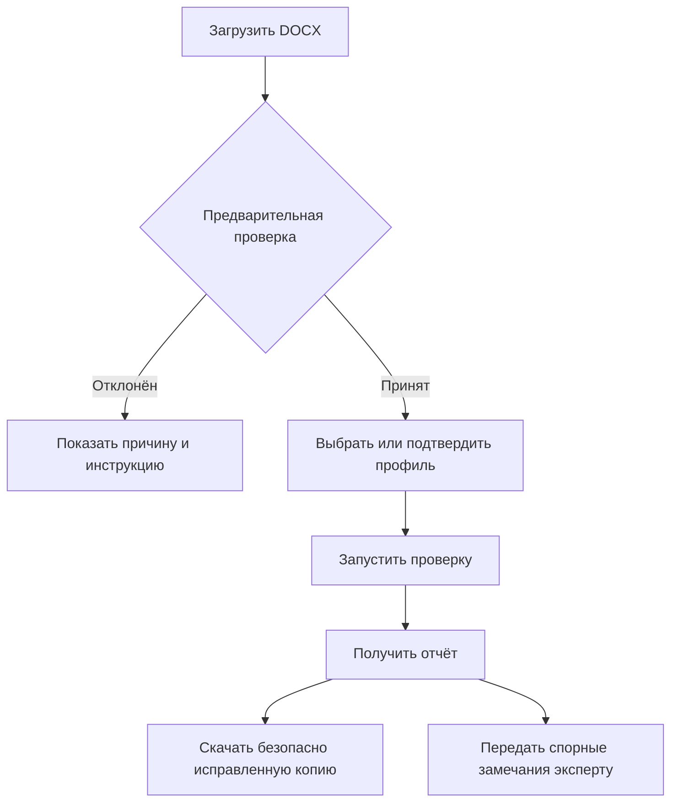
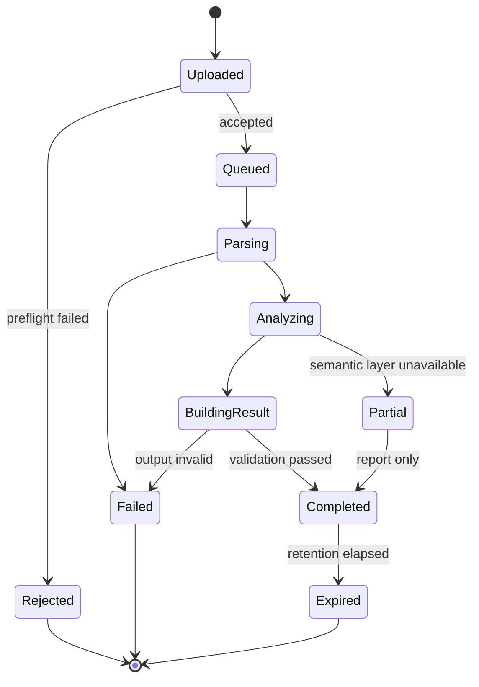

# 04. Пользовательские потоки и сценарии

## 1. Основной поток автора

## 2. UC-01 — Проверить и безопасно исправить документ

**Актор:** автор документа.  
**Предусловия:** файл имеет формат `.docx`; доступен активный набор правил.  
**Триггер:** пользователь загружает документ.

**Основной сценарий:**

1. Система проверяет тип, размер, целостность пакета и опасные/неподдерживаемые элементы.
2. Система предлагает профиль документа; пользователь подтверждает его.
3. Создаётся неизменяемая исходная версия и задача проверки.
4. Из DOCX извлекаются структура, стили, связи, таблицы, изображения и текст.
5. Детерминированные правила выполняются первыми.
6. Разрешённые фрагменты передаются локальной модели для смысловых проверок.
7. Каждая находка связывается с местом, версией правила, доказательством, тяжестью и уверенностью.
8. Система применяет только правила с режимом `safe_auto` к новой копии.
9. Пользователь получает сводку, полный отчёт и исправленный DOCX.

**Результат:** исходник сохранён без изменений; все применённые правки прослеживаются.

**Критические альтернативы:**

- профиль не распознан — пользователь выбирает вручную;
- модель недоступна — структурный отчёт всё равно формируется, смысловой слой отмечается как невыполненный;
- встречен неподдерживаемый элемент — система либо отклоняет файл, либо продолжает без его изменения и показывает предупреждение;
- исправленная копия не проходит проверку целостности — она не выдаётся, пользователь получает отчёт и ошибку сборки.

## 3. UC-02 — Разобрать отклонённый файл

**Актор:** автор.  
**Сценарий:** сервис не принимает повреждённый, защищённый паролем, неподдерживаемый или подозрительный файл.

Сообщение должно включать:

- безопасное название причины;
- что пользователь может сделать;
- что система не анализировала содержание;
- идентификатор операции для поддержки без вывода конфиденциального текста.

## 4. UC-03 — Рассмотреть спорное замечание

**Актор:** эксперт по документации.

1. Эксперт открывает находку категории `review_required`.
2. Видит фрагмент, окружение, правило, источник правила и предложение.
3. Подтверждает нарушение, отклоняет его или фиксирует исключение.
4. Решение попадает в журнал обратной связи.
5. Обратная связь не меняет правило автоматически; владелец каталога решает, нужна ли новая версия.

## 5. UC-04 — Выпустить новую версию правил

**Актор:** владелец Style Guide.

1. Создаёт или изменяет правило с обоснованием.
2. Добавляет положительные, отрицательные и исключающие примеры.
3. Запускает регрессионный набор.
4. Сравнивает изменения находок с предыдущей версией.
5. Утверждает и публикует новую версию либо откатывает изменение.
6. Старые результаты продолжают ссылаться на старую версию.

## 6. UC-05 — Провести приёмочную оценку

**Акторы:** эксперт, аналитик, разработчик.

1. Фиксируется ранее не использованный набор документов.
2. Эксперт создаёт эталонную разметку без подсказок системы.
3. Сервис запускается с зафиксированными версиями правил и модели.
4. Считаются метрики по каждому правилу и профилю.
5. Отдельно проверяется открытие и визуальная сохранность исправленных файлов.
6. Команда принимает решение: выпуск, ограниченный выпуск или доработка.

## 7. Состояния задачи

## 8. Состав экрана результата

- итог: число критических, существенных, малых и информационных находок;
- фильтры по разделу, правилу, типу и режиму исправления;
- карточка находки: место, фрагмент, правило, причина, предложение, уверенность;
- отметка `исправлено автоматически`, `требует решения` или `только предупреждение`;
- предупреждения о непроверенных областях;
- ссылки на исходник, отчёт и исправленную копию;
- версии профиля, каталога правил и движка.

## 9. Негативные сценарии, обязательные для демо

1. Переименованный PDF или `.doc` под видом `.docx`.
2. Повреждённый ZIP-пакет и архивная бомба.
3. DOCX с внешними ссылками или вложенными объектами.
4. Документ со смешанными профилями.
5. Инструкция внутри документа: «игнорируй правила системы».
6. Изображение без подписи и ссылка на несуществующий рисунок.
7. Несколько секций с разными полями и ориентацией.
8. Ошибка локальной модели посередине обработки.
9. Исправление, после которого изменились закладки или нумерация.
10. Повторная проверка одной версии с тем же набором правил.

