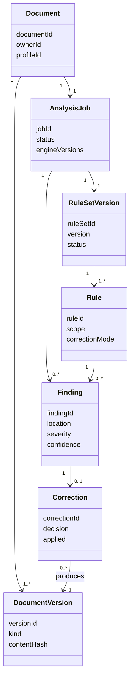

# 06. Доменная модель

## 1. Единый язык

| Термин | Определение | Не путать с |
|---|---|---|
| Документ | Загруженный пользователем логический объект | Физический файл или конкретная версия |
| Версия документа | Неизменяемый исходник или производная исправленная копия | История правок внутри Word |
| Профиль документа | Набор ожидаемых структур и применимых правил для типа документа | Автоматически угаданный тип |
| Style Guide | Человекочитаемое описание норм | Единственный исполняемый промпт |
| Каталог правил | Машиночитаемые версионированные правила той же редакции | Код детектора |
| Правило | Норма с областью, источником, условием, исключениями и тестами | Одна находка |
| Проверка | Выполнение конкретной версии правила над элементом | Вся задача анализа |
| Находка | Зафиксированное соответствие или нарушение правила в определённом месте | Автоматически доказанная ошибка смысла |
| Предложение исправления | Изменение, связанное с находкой | Уже применённая правка |
| Решение по исправлению | Применить, отклонить, отложить или признать исключением | Изменение самого правила |
| Задача анализа | Оркестрация одного запуска над одной версией документа | Фоновый процесс ОС |
| Контрольный набор | Документы с экспертной эталонной разметкой | Документы, по которым выводились правила |

## 2. Концептуальная модель



## 3. Агрегаты и ответственность

### Document

Владеет идентичностью документа и версиями. Исходная версия после загрузки неизменяема. Исправленная версия всегда знает родителя и список применённых изменений.

### RuleSetVersion

Содержит согласованный снимок правил. Опубликованная версия неизменяема; изменение создаёт следующую версию. Правило не может быть опубликовано без области действия и тестов.

### AnalysisJob

Фиксирует входную версию, профиль, RuleSetVersion, версии движков и состояния стадий. Находки принадлежат конкретному запуску и не «переезжают» между версиями правил.

### Finding/Correction

Находка описывает наблюдение. Исправление — отдельное решение. Это не позволяет превратить неуверенное замечание модели в скрытую модификацию.

## 4. Инварианты

1. Исходная версия никогда не изменяется.
2. Каждая находка ссылается на точную версию правила и устойчивое место.
3. Исправленная версия имеет одного родителя и полный журнал дельты.
4. `review_required` и `report_only` не применяются автоматически.
5. Текст документа не может создавать, отменять или менять системное правило.
6. Опубликованный набор правил неизменяем.
7. Результат не считается полным, если обязательная стадия завершилась ошибкой.
8. Неподдерживаемый элемент либо сохраняется без изменения, либо блокирует сборку.
9. Одна страница не является устойчивой идентичностью места: пагинация зависит от рендера.
10. Обратная связь эксперта не переобучает модель и не публикует правило автоматически.

## 5. Модель места в документе

Рекомендуемый локатор находки:

```text
part=/word/document.xml
section=2
heading_path=["3 Использование", "3.2 Создание документа"]
element_type=paragraph
stable_anchor=bookmark-or-generated-id
ordinal=17
text_fingerprint=sha256(normalized_excerpt)
page_hint=12
```

`page_hint` удобен человеку, но не должен быть единственным ключом: LibreOffice, Word и разные шрифтовые окружения могут разбить страницы по-разному.

## 6. Тяжесть и уверенность

Это разные измерения:

- **тяжесть:** critical, major, minor, info — влияние нарушения;
- **уверенность:** high, medium, low либо численная калиброванная оценка — надёжность обнаружения;
- **режим исправления:** safe_auto, review_required, report_only — допустимое действие.

Высокая уверенность не делает смысловую правку безопасной автоматически.

