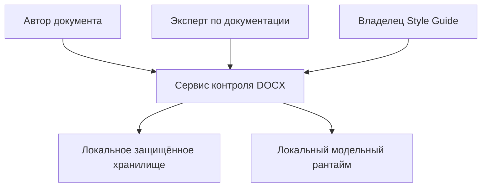
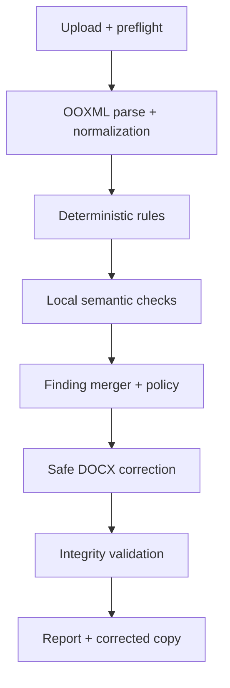

# 07. Границы системы и варианты решения

## 1. Контекст

На MVP система не обращается к репозиторию, 1С, внешнему LLM API или базе знаний заказчика. Локальность модели не отменяет необходимость защищать загрузку, временные файлы, логи и резервные копии.

## 2. Варианты

| Вариант | Сильные стороны | Слабые стороны | Решение |
|---|---|---|---|
| A. Только LLM и большой промпт/скилл | Быстрое демо, простая разработка | Нестабильность, слабая работа с OOXML, трудно тестировать, риск выдуманных правил | Отклонить как ядро |
| B. Только детерминированный движок | Воспроизводимость, точные форматные проверки | Слабая работа с языком и логикой | Хороший первый этап, но не полный продукт |
| C. Гибрид правил и локальной LLM | Точность там, где возможно; гибкость для языка | Больше компонентов и оценок | Рекомендуется |
| D. Word add-in | Удобная проверка в процессе написания | Интеграционная сложность, зависимость от Word | После пилота |

## 3. Рекомендуемый конвейер

### Компоненты

1. **Upload gateway:** ограничения формата и размера, антивирус/сканер, безопасное имя, квоты.
2. **Preflight sandbox:** распаковка с лимитами, анализ relationships, запрет активного содержимого.
3. **OOXML adapter:** модель абзацев, runs, стилей, списков, секций, таблиц, изображений, подписей и ссылок.
4. **Rule engine:** исполняет машиночитаемый каталог и сохраняет доказательства.
5. **Semantic checker:** получает минимально нужные фрагменты и возвращает данные по строгой схеме.
6. **Policy layer:** объединяет находки, устраняет дубли и определяет допустимое действие.
7. **Correction engine:** меняет новую копию на уровне OOXML, не перегенерируя весь документ.
8. **Validator/render check:** открываемость, OOXML-валидация, связи и визуальное сравнение контрольных страниц.
9. **Job/API/UI:** фоновые задачи, статусы, отчёты и загрузка результатов.

## 4. Почему Style Guide — не только «скилл»

Промпт полезен как инструкция модели, но плохо подходит на роль нормативной базы:

- его трудно связать с конкретным нарушением и тестом;
- изменение текста меняет множество поведений сразу;
- детерминированные проверки не должны зависеть от модели;
- правила разных профилей и исключения быстро становятся неуправляемыми;
- безопасность не должна опираться на секретность или непротиворечивость промпта.

Рекомендуется генерировать часть модельной инструкции из опубликованного каталога правил, а не вручную дублировать нормы.

## 5. Что не фиксировать до spike

Пока рано выбирать:

- конкретную локальную модель и размер контекста;
- GPU/CPU и схему масштабирования;
- библиотеку редактирования DOCX;
- способ рендера и сравнения страниц;
- постоянную СУБД и очередь;
- микросервисную или модульно-монолитную реализацию.

Выбор должен следовать после трёх экспериментов: сохранность сложного DOCX, качество смысловых правил и производительность на целевом железе.

## 6. Технические решения, которые уже достаточно устойчивы

- отдельный веб-сервис;
- асинхронная задача анализа;
- DOCX/OOXML как единственный вход MVP;
- неизменяемый исходник и производная копия;
- версионированные правила и трассировка;
- изолированный парсинг недоверенного файла;
- отсутствие внешней передачи содержимого;
- запрет скрытых смысловых автоисправлений.

## 7. Внешние технические ориентиры

- [ECMA-376 Office Open XML](https://ecma-international.org/publications-and-standards/standards/ecma-376/) — структура и упаковка OOXML.
- [Microsoft WordprocessingML](https://learn.microsoft.com/en-us/office/open-xml/word/structure-of-a-wordprocessingml-document) — модель документа Word.
- [OWASP File Upload Cheat Sheet](https://cheatsheetseries.owasp.org/cheatsheets/File_Upload_Cheat_Sheet.html) — защита загрузки.
- [OWASP Prompt Injection Prevention](https://genai.owasp.org/llmrisk/llm01-prompt-injection/) — недоверенные инструкции в документе.
- [NIST AI 600-1](https://www.nist.gov/publications/artificial-intelligence-risk-management-framework-generative-artificial-intelligence) — управление рисками генеративного AI.

