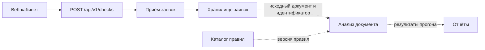

# Приём документа для проверки

## HLD

Локальный бэкенд предоставляет одну операцию для контекста приёма заявок. В интерфейсе пользователь выбирает DOCX. Веб-кабинет передаёт файл через Vite-прокси, а API подтверждает приём после сохранения заявки в памяти процесса.



Пунктир обозначает целевую схему следующих итераций. Для анализа предполагается отдельный запуск над неизменяемым исходником и выбранной версией правил. Каталог владеет версиями правил, анализ владеет выполнением, отчёт собирает замечания для пользователя. Эти границы логические и допускают модульный монолит. См. [доменную модель](../project-analysis/06-domain-model.md) и [компоненты проекта](../project-analysis/07-system-boundaries-and-options.md).

## LLD

| Слой | Ответственность |
| --- | --- |
| `backend/domain` | `Check` представляет заявку с уникальным `checkId` и начальным статусом `queued`. `SubmittedDocument` хранит имя и неизменяемые байты исходника. |
| `backend/core` | `SubmitCheck` проверяет расширение и структуру через `DocumentInspector`, затем создаёт заявку и передаёт её в `CheckRepository`. |
| `backend/infrastructure` | `DocxInspector` проверяет структуру пакета. `InMemoryCheckRepository` сохраняет заявку вместе с исходником. |
| `backend/http.py` | Flask разбирает multipart, применяет лимит, преобразует результат в HTTP и связывает реализации с Core в `create_app`. |

Core зависит от Domain и объявляет узкие интерфейсы под свой сценарий. Адаптеры реализуют эти интерфейсы структурно. Domain использует стандартную библиотеку Python. Обработчик отдаёт `202` после сохранения. Неподходящий файл отклоняется до создания заявки. Повторная отправка создаёт новую заявку с новым идентификатором.

Лимит локального запроса составляет **10 МиБ на всё тело multipart**. Для DOCX предварительно проверяются ZIP-контейнер, стандартные части `_rels/.rels` и `word/document.xml`, отсутствие шифрования ZIP и тип основной части в `[Content_Types].xml`. Содержимое документа будет проверять отдельный этап анализа. Заявки и файлы живут до остановки процесса. Сервер рассчитан на локальный показ с синтетическими документами.

## Запуск и проверка

Из корня backend-ветки с Python 3.11 или новее.

```powershell
python -m pip install -r backend/requirements.txt
python -m flask --app backend.http run --host 127.0.0.1 --port 8000
```

API доступен на `http://127.0.0.1:8000/api/v1/checks`. В другом терминале можно создать синтетические файлы и проверить три сценария.

```powershell
$fixtures = Join-Path $env:TEMP 'doccheck-fixtures'
python -m backend.tests.fixtures "$fixtures"
$api = 'http://127.0.0.1:8000/api/v1/checks'

curl.exe -i -F "file=@$fixtures/example.docx" $api
curl.exe -i -F "empty=" $api
curl.exe -i -F "file=@$fixtures/example.txt" $api
```

| Сценарий | HTTP | Пример JSON |
| --- | --- | --- |
| DOCX принят | 202 | `{"checkId":"chk_7cfcb075469c45df9dff1eba494aef7d","status":"queued"}` |
| Поле `file` отсутствует | 400 | `{"error":{"code":"FILE_REQUIRED","message":"Выберите документ для загрузки."}}` |
| Неподдерживаемое расширение | 415 | `{"error":{"code":"UNSUPPORTED_FILE_FORMAT","message":"Выберите файл в формате DOCX."}}` |

Несколько файлов дают `400 INVALID_REQUEST`. Превышение лимита даёт `413 FILE_TOO_LARGE`. Ошибка предварительной проверки содержимого DOCX даёт `422 INVALID_DOCUMENT`. Автотесты проверяют ответы и отсутствие сохранённых заявок при отказе.

```powershell
python -m unittest discover -s backend/tests -v
```

Для проверки с [frontend v1.1](https://github.com/Stepik96/ai-documentation-quality-control/pull/1) запустите `npm.cmd ci` и `npm.cmd run dev` в каталоге `frontend` отдельного checkout ветки `frontend`. Vite отправляет `/api` на `http://127.0.0.1:8000` из коробки. Если изменили адрес бэкенда, задайте `API_PROXY_TARGET` в `frontend/.env.local` и перезапустите Vite. В браузере отправьте DOCX, затем TXT и замените его на DOCX. Ожидаются подтверждение приёма, сообщение о формате и успешная повторная загрузка.
